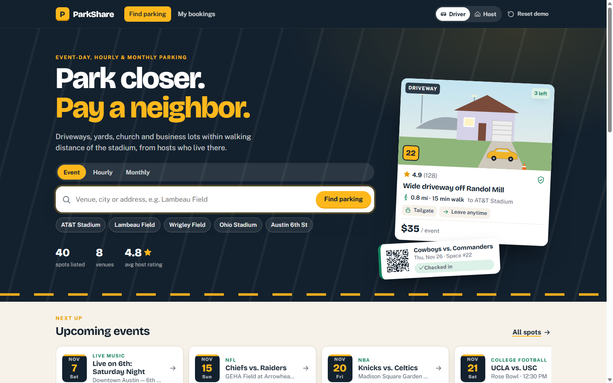
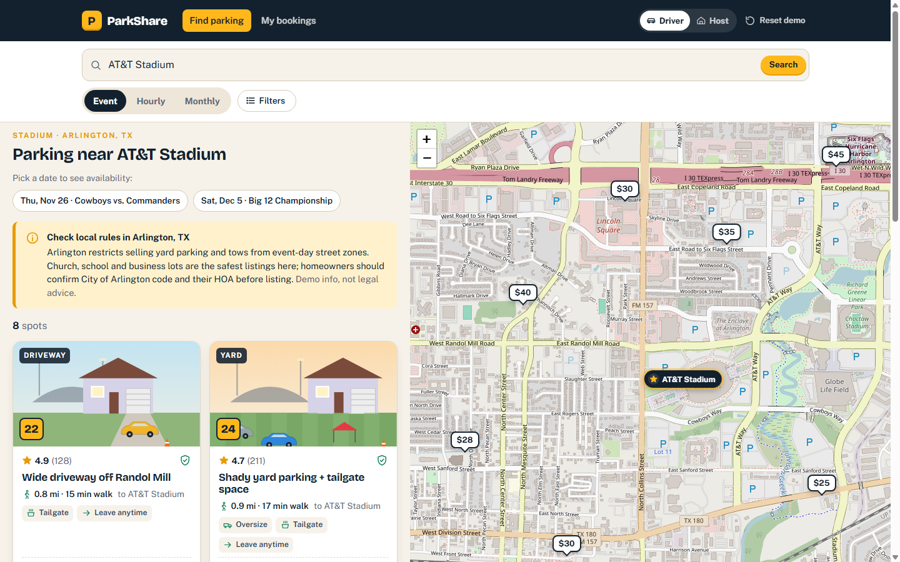
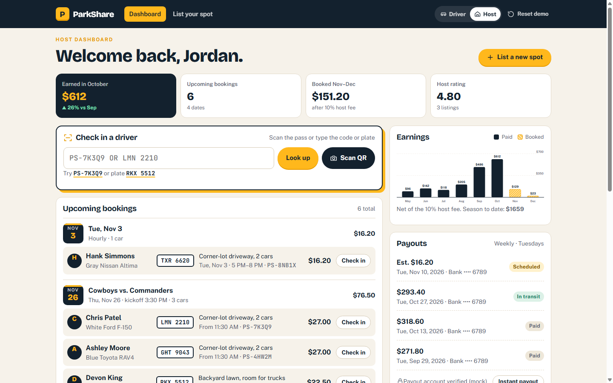
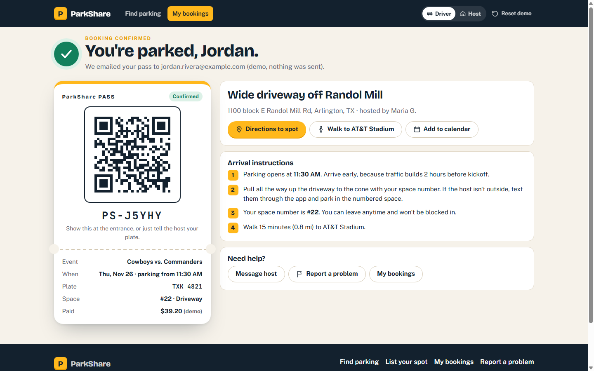
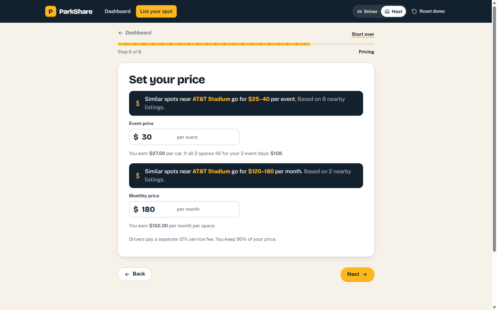

# ParkShare: event-day parking from neighbors

**Live demo:** https://527443.github.io/parkshare/app/

Parking near stadiums, concert venues and busy downtowns is expensive and sells out, while driveways, church lots and business lots a short walk away sit empty. ParkShare is a clickable demo of a two-sided marketplace where those neighbors rent their spaces to drivers on game day, by the hour or by the month.



## Features

**Drivers**
- Search by venue, city or address, with Event / Hourly / Monthly booking
- Interactive map with price pins, walking time to the venue and filters (EV, oversize, tailgating, leave anytime)
- Spot details, transparent price breakdown, mock checkout ("demo, no charge")
- Parking pass with QR code, directions, arrival steps and add-to-calendar
- My bookings with policy-based cancellation refunds and reviews

**Hosts** (homeowners, businesses, churches, schools)
- 8-step "List your spot" wizard with event detection and price suggestions from nearby listings
- Required "I have the right to rent this space (HOA/lease/city rules)" attestation
- Dashboard with earnings chart, payouts and check-in by booking code or license plate

**Trust & safety:** verified-host badges, per-city local-rules banners, reviews and report-a-problem flows.

| Search & map | Host dashboard |
|---|---|
|  |  |
| **Parking pass** | **Listing wizard** |
|  |  |

## Tech
Plain HTML, CSS and JavaScript with no build step, Leaflet + OpenStreetMap for maps, and `localStorage` for sample data. Mobile-first and responsive.

## Run locally
```
cd app
python -m http.server 8080   # or: npx serve .
```
Then open http://localhost:8080. You can also double-click `app/index.html`.

## Demo limitations
All data is sample data; payments, payouts, ID verification and email are mocked. The QR code is a visual placeholder, address search only matches the seeded venues and streets, and the local-rules banners are illustrative, not legal advice.
